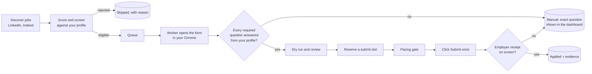

<h1 align="center">OpenJobApply</h1>

<p align="center">
  <b>A local, profile-driven job-application assistant that never invents an answer.</b><br>
  Your signed-in Chrome, your résumé, your facts, your machine. Every application is recorded in a ledger, and only an employer-confirmed receipt counts.
</p>

<p align="center">
  <a href="https://github.com/sm7/openjobapply/actions/workflows/ci.yml"></a>
  <a href="LICENSE"></a>
  
  
  
</p>

> [!WARNING]
> **`start` and `service start` can submit real job applications on your behalf.** Setup, configuration, `doctor` and `status` never submit anything.
> Many job sites forbid automated applications in their terms of service, and automation can get an account restricted or banned. You are responsible for every application sent, for the accuracy of your profile, and for following each site's terms and the law. Read [Responsible use](#responsible-use) before you start. The software is provided as is, with no warranty.

---

## Contents

[Why](#why-openjobapply) · [How it works](#how-it-works) · [Safety model](#safety-model) · [Quick start](#quick-start) · [Your profile](#your-profile-the-source-of-truth) · [Running](#running) · [Dashboard](#dashboard) · [Configuration](#configuration) · [Recovery](#recovery-and-evidence) · [Layout](#project-layout) · [Testing](#testing) · [Limits](#status-and-honest-limits) · [Contributing](#contributing)

---

## Why OpenJobApply

Most "auto-apply" tools optimise for volume. They guess answers, click through anything and tell you how many applications they sent. OpenJobApply optimises for **truthful, auditable applications**:

- **Facts come from one file.** `profile.json` holds your identity, work history, confirmed answers and permissions. If a form asks for something the file does not hold, the worker **stops and tells you the exact question**. It does not guess.
- **A job is applied to at most once.** A reservation is made before the final Submit, duplicates are checked across job id, URL and source id, and a crash after Submit leaves a trace that blocks a blind retry.
- **Only a real receipt counts.** A timeout, an upload or a reservation is never counted as a success. A job is `applied` only with an active reservation and recorded employer-confirmation evidence.
- **It moves like a person.** Page loads, job details and submissions are paced, and real platform lockouts are remembered across restarts.
- **Everything stays on your machine.** A Python CLI, a SQLite file and a loopback-only dashboard. No account, no cloud, no telemetry.

## How it works



Three processes cooperate. They share a SQLite database and a few small files, and never call each other directly:

| Process | Role |
|---|---|
| **Supervisor** (`campaign.py loop`) | Holds a singleton lock, starts one AI worker per round, enforces a deadline, cleans up the worker's whole process tree, and turns any unresolved reservation into a *manual* outcome. |
| **Worker** (the [`omp`](https://ohmypi.xyz/) agent) | Drives your real Chrome through the omp browser relay. It reads `profile.json`, fills forms through the adapters and calls the controller commands `reserve`, `gate` and `result`. |
| **Dashboard** (`campaign_monitor.py`) | A loopback-only web page that shows progress, logs, receipts and blocked jobs. |

Supported applications: LinkedIn Easy Apply, plus employer sites through adapters for **ADP, Greenhouse, Lever, Workday, iCIMS, SmartRecruiters and Ashby**. Any other site gets a generic read-only dry run, and the worker may finish it by hand under the same rules.

## Safety model

| Guarantee | How it is enforced |
|---|---|
| No guessing | Answers come from `profile.json` through a rule engine. An unknown required question ends the job as *manual* with its exact wording. |
| One application per job | `reserve` runs in one `BEGIN IMMEDIATE` transaction and checks job id, URL and source id against every applied job and open reservation. |
| Reservation before Submit | An `applied` outcome is accepted only while a `reserved` row exists for that job. |
| Receipt required | `applied` needs non-empty evidence. The adapters return `applied` only on confirmation text. iCIMS also requires that no fields and no Submit control remain. |
| Crash safety | After a crash, every open reservation becomes *manual*, never *applied*, and is never retried automatically. |
| Pacing and lockouts | 8 to 20 s between page loads, 60 to 180 s before a submit, 90 s or more per employer host. Challenges lock a host for 30 min, 2 h, 12 h, then 24 h. LinkedIn challenges lock for 6 h. State survives restarts. |
| No consents by default | Marketing, job alerts, arbitration, non-competes, background, drug and credit checks and legal releases are never accepted unless a reviewed grant in your profile covers the exact scope. |
| Demographic questions | The worker declines to self-identify. Only two reviewed Yes/No facts can be used when a form offers no decline option. |
| No secrets in config | Employer passwords go through a hidden prompt into an owner-only vault file. Nothing secret is placed in the profile, in arguments or in logs. |
| Private dashboard | Loopback only. Every route checks the `Host` header, which defeats DNS rebinding. The two write routes also require a per-install token, a matching `Origin` and a JSON body. |

**What this model does not promise.** The worker is an AI agent with shell access. The controller, the adapters and the database enforce the rules above, but a worker that ignores its instructions could still misbehave in a way the code cannot see. Treat it like a capable assistant you supervise, not like a sandbox. See [Status and honest limits](#status-and-honest-limits).

## Quick start

### 1. Prerequisites

- macOS or Linux, **Python 3.10+**. There are no Python packages to install.
- **[Oh My Pi (`omp`)](https://ohmypi.xyz/)** on your `PATH`, signed in to your model provider. Checked with omp 18.19.0.
- **Chrome** with the omp browser-relay extension, signed in to the job sites you want to use.
- A PDF résumé.

```sh
omp login
omp browser-relay install     # load the printed folder in chrome://extensions
omp browser-relay             # keep this running (default port 9224)
```

### 2. Get the code

```sh
git clone https://github.com/sm7/openjobapply.git
cd openjobapply
```

### 3. Fill in your profile

```sh
cp profile.example.json profile.json     # then edit profile.json
python3 jobapp.py setup --resume /path/to/resume.pdf
python3 jobapp.py config validate
python3 jobapp.py doctor
```

Until the profile is complete the project is **non-submittable**: `validate`, `doctor` and `start` refuse and name the field that is missing. See [Your profile](#your-profile-the-source-of-truth).

### 4. Check the state before you apply

```sh
python3 jobapp.py status
```

Start with a small target, for example `python3 jobapp.py config set campaign.target_total 3`. Watch the first rounds in **Live logs**, and check each submission in **Applied jobs**.

### 5. Start

```sh
python3 jobapp.py start          # supervisor and dashboard in this terminal
# dashboard: http://127.0.0.1:8765
```

Stop at any time with `Ctrl-C` or `python3 jobapp.py stop`. History is kept.

## Your profile: the source of truth

`profile.example.json` lists **every fact the program can use**. Copy it to `profile.json` (gitignored) and fill in what you can confirm.

> **`null` means unknown.** A form that asks about an unknown fact stops for you. Never fill in a value you cannot stand behind.

| Section | What it holds |
|---|---|
| `candidate` | Name, email, phone, address, LinkedIn, résumé path, work authorization, sponsorship, citizenship. |
| `preferences` | Location mode, remote, salary floor and expectation, travel, relocation, employment types. |
| `search` | Queries, title words to include and exclude, skills, maximum years of experience required. |
| `search` (scoring words) | `core_title_words`, `role_words`, `context_words`, `domain_words` and `title_out_of_lane` describe **your** field. The scorer reads them and nothing about your field is built into the code. |
| `answers` | Confirmed answers to common screening questions: work history, education, compliance Yes/No facts, consents, years of experience per skill. |
| `answers.reviewed_questions` | `{ "exact question as the employer words it": answer }`. Matched exactly, never by keyword. |
| `application_permissions` | Account creation, password reset, Google sign-in and mailbox verification. All `false` by default. |
| `application_instructions` | Free-text exceptions that apply to one exact job. They cannot waive any safety protection. |

Your home state is read from `candidate.state` or from the end of `candidate.location`, so a residency rule such as "we cannot hire in Texas" applies to **your** state and no other.

Salary ranges use their **midpoint**, not the maximum. Unknown salary follows `preferences.unknown_salary` (`allow` or `reject`).

A reviewed answer is a fact you vouch for. If one is wrong, the engine repeats it on every matching question, so review those entries carefully. Reviewed answers never settle consent, background-check, legal-release or identity questions.

## Running

### Foreground

```sh
python3 jobapp.py start                 # supervisor + dashboard
python3 jobapp.py start --no-dashboard  # supervisor only
python3 jobapp.py status --json         # from another terminal
python3 jobapp.py stop
```

`Ctrl-C` performs a bounded cleanup of the worker. An interrupted submission stays quarantined until you have checked the employer's side. Starting a second time while the lock is held never launches a second worker.

### Background service

```sh
python3 jobapp.py service install     # writes the definitions, starts nothing
python3 jobapp.py service start       # idempotent, never restarts a live worker
python3 jobapp.py service status
python3 jobapp.py service stop
python3 jobapp.py service uninstall   # removes only its own definitions
```

- **macOS:** user LaunchAgents in `~/Library/LaunchAgents`.
- **Linux:** `systemd --user` units in `~/.config/systemd/user`. A working user session is required. Otherwise use the foreground mode.

No `sudo` is ever used. Give each separately deployed copy its own `campaign.runtime.service_name`.

The machine must stay awake, with a usable desktop session, Chrome and the relay running. Without the relay the supervisor waits and starts no worker. After you update the Python source, restart the supervisor **at an idle moment, never during an uncertain Submit**.

## Dashboard

Open **http://127.0.0.1:8765**. It binds to loopback only.

| Tab | Purpose |
|---|---|
| **Overview** | Target and progress, current activity, pacing and supervisor health. Liveness is not proof of a submission. |
| **Applied jobs** | Every confirmed application with its confirmation sentence and receipt screenshot. |
| **Manual jobs** | Jobs the worker could not finish, with the exact reason and whether an application *may* have reached the employer. Add answers and queue the job again. |
| **Skipped jobs** | Jobs the scorer or the worker skipped, with the reason and a duplicate-risk warning. Request a fresh review of one. |
| **Live logs** | Metadata-only events. Raw worker output, credentials and receipt text never appear. |

Overview, Applied jobs and Live logs are read-only. Manual jobs and Skipped jobs each have one write route, guarded by the checks above. Saving an answer queues a job again in the **same database transaction**, so a rejected request never leaves an orphan answer. It never submits anything by itself.

## Configuration

Two files are authoritative: **`profile.json`** (you) and **`data/campaign.json`** (the run: target, model, caps, priorities, runtime).

```sh
python3 jobapp.py config show profile
python3 jobapp.py config set profile.preferences.min_salary_usd 75000
python3 jobapp.py config set profile.search.queries '["data analyst", "business intelligence analyst"]'
python3 jobapp.py config set campaign.target_total 50          # null = continuous, 0 = closed
python3 jobapp.py config set campaign.worker_model 'provider/model-id'
python3 jobapp.py config validate
```

Writes are validated, serialised and atomically replaced. An invalid change leaves the old file untouched.

- **Caps:** `null` means unlimited and `0` disables the action. Action spacing, reservations, duplicate checks, receipts and platform lockouts are enforced whatever the caps say.
- **Runtime:** `worker_timeout_seconds`, `success_pause_seconds`, `idle_pause_seconds`, `dashboard_port`, `service_name` and `credentials_file` live under `campaign.runtime`. Changes apply at the next worker round, and a running form is never interrupted.
- **Employer passwords:** `python3 jobapp.py credential employer.example --email you@example.com` reads the password from a hidden prompt. It is never an argument.

The full reference is in [`docs/configuration.md`](docs/configuration.md).

## Recovery and evidence

SQLite history, reservations, pacing state and receipts survive restarts. Two operator commands exist for reviewed recovery, and neither bypasses a safety rule:

- `python3 src/campaign.py requeue JOB_ID` returns a job to the queue. It needs a `reason`, `evidence` and `submission_verified_absent: true`, and it rejects any job that is applied or has an active equivalent.
- `python3 src/campaign.py reconcile JOB_ID` records a receipt you verified by hand for a manual or failed attempt **without resending**.

If a job shows **"May have been submitted"**, check the employer's account before you queue it again. Missing evidence is not proof that nothing was sent.

## Project layout

```text
jobapp.py            CLI: setup, config, doctor, start, stop, status, service, credential
profile.example.json the template for every fact you provide
src/
  campaign.py        controller and supervisor: reserve, gate, result, requeue, reconcile
  score.py           hard filters and fit score, driven by your profile
  ingest.py          index, dedupe and score discovered jobs  (--report, --why JOB_ID)
  ats/               answer engine, form filler, pacing and the ATS adapters
  campaign_monitor.py, *_ui.py   the loopback dashboard
  CAMPAIGN_WORKER.md the worker's instructions
test/                Python tests and browser-fixture tests, all with fictional data
docs/                architecture, safety model, dashboard, configuration, testing, known gaps
scripts/             docs checker and the privacy scan
```

Start with [`docs/architecture.md`](docs/architecture.md), then [`docs/safety-model.md`](docs/safety-model.md). The index is [`docs/README.md`](docs/README.md).

## Testing

```sh
python3 -m unittest discover -s test -p 'test_*.py'     # 337 tests, standard library only
python3 scripts/check_docs.py
python3 scripts/check_privacy.py
bun test/fixtures/ats/answers_standing.test.js           # answer rules, no browser
bun test/fixtures/ats/answers_consents.test.js
bun test/fixtures/ats/pacing.test.js
```

The Python suite has run on Python 3.10, 3.12 and 3.15. CI runs it on Linux and macOS across Python 3.10 to 3.13.

The browser fixture suites (`run.js`, `icims`, `workday`, `sr_ashby`, `account*`) drive fake employer pages through the `omp` `browser` global and are run from an `omp` eval cell, as each test's header explains. **No test submits a real application**, and all test data is fictional (`test/fixtures/profile.fixture.json`).

## Status and honest limits

- **Built around one real workflow.** The engine was developed against one candidate's real applications and then generalised. Candidate facts now live in the profile and a test fails if a home state, city or field returns to the source. Some question templates in `src/ats/answers.js` come from that history. They are inert unless your profile holds the matching fact, and you can replace them with `reviewed_questions`.
- **macOS first.** The author ran it on macOS. Linux support, including `systemd --user`, is fixture-tested and runs in CI, but it has not had a long live run.
- **Employer forms change.** The adapters use fixtures, not live pages. A redesign can break one. The result should be a *manual* outcome with the exact blocker, not a wrong submission.
- **The scorer is rule-based.** It can reject a good job or accept a poor one. `python3 src/ingest.py --report` shows why jobs were rejected and `--why JOB_ID` shows the text behind one decision.
- **The worker is an AI agent.** See [Safety model](#safety-model). Read the dry run, start with a small `target_total`, and watch the dashboard.
- **Not a cloud service.** It needs an awake machine, a logged-in desktop session, Chrome and the relay.

Known gaps are listed candidly in [`docs/known-gaps.md`](docs/known-gaps.md).

## Responsible use

- Use it only for your own applications and only where automation is allowed. Check the terms of every site you point it at.
- Do not use it to submit false information. Everything it types comes from your profile, so keep that file accurate.
- Start with a low target and with `max_submissions_per_day` set, and keep the default pacing.
- Do not remove the pacing, the reservation or the receipt checks to go faster.
- Never copy another person's profile, answers, permissions or application history.

## FAQ

**Does it write my answers with an AI model?** No. Answers come from your profile through fixed rules. The model drives the browser and follows the worker instructions, but an answer that is not in the profile stops the job.

**Where does my data go?** Nowhere beyond the sites you apply to and your model provider, which sees whatever the worker's session contains. The profile, database, résumé and logs stay on your disk and are gitignored.

**Why does it stop so often at first?** Every unknown required question stops the job on purpose. Answer each one once, in the dashboard for that job or in `answers.reviewed_questions` for every job, and the number of stops falls quickly.

**Can I run it for several people?** Keep one project folder, database and `service_name` per candidate.

**Can I stop it safely?** Yes. `Ctrl-C` or `python3 jobapp.py stop` ends the worker cleanly and keeps all history. An unresolved submission is quarantined until you review it.

## Contributing

Issues and pull requests are welcome.

1. Fork, branch and run the tests above.
2. **Use only fictional data** in tests and docs: the persona is Jane Doe, with `example.com` addresses and 555-01xx phone numbers. `python3 scripts/check_privacy.py` must report 0 findings. You can list your own name and employers in a gitignored `.privacy-denylist`, one per line, to catch accidental leaks.
3. Keep candidate facts out of `src/`. They belong in `profile.json`.
4. Add a test for each behaviour change. A rule that answers a question needs a near-miss test showing what it must **not** answer.
5. Docs follow a short plain-English style. `python3 scripts/check_docs.py` checks the mechanical rules.

Please report a security problem privately to the maintainer rather than in a public issue.

## License

[MIT](LICENSE). The software is provided "as is", without warranty of any kind. You alone are responsible for how you use it.
